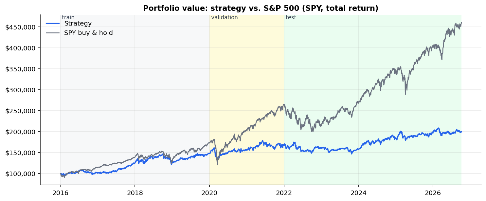
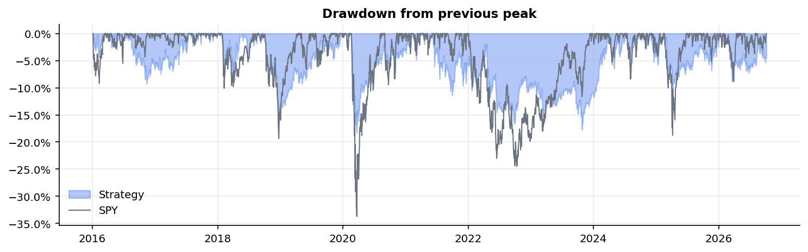
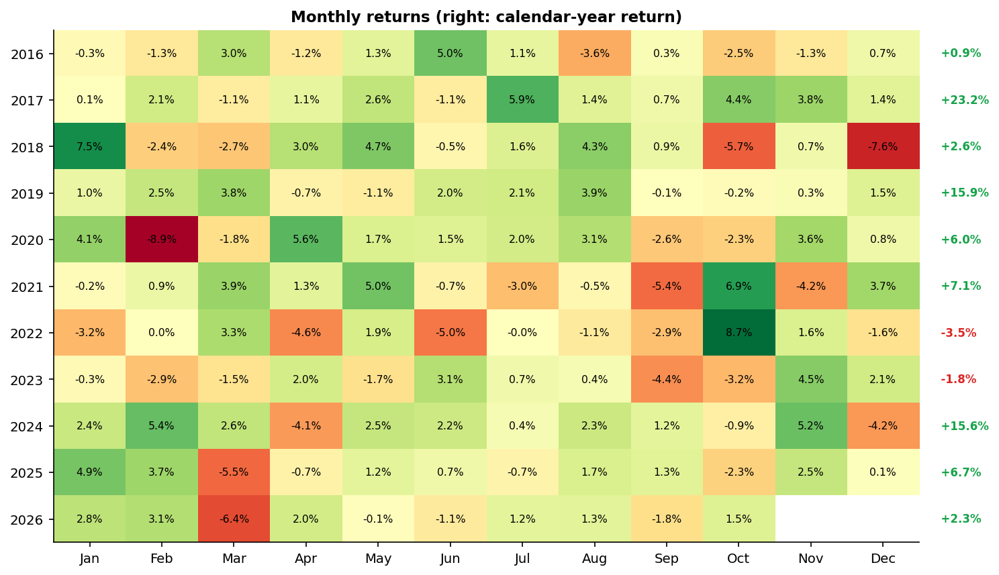
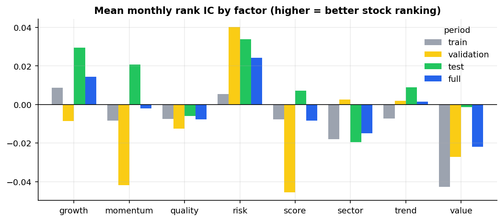
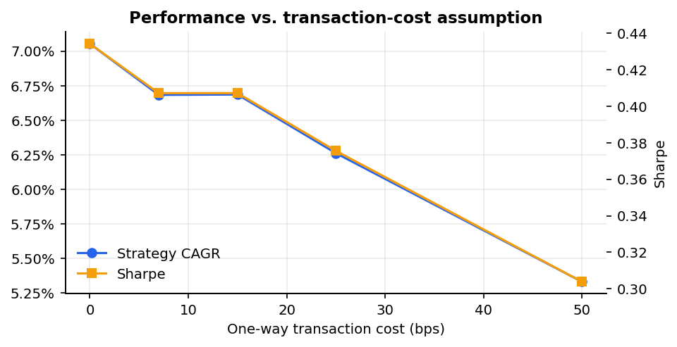

# Algorithmic U.S. Equity Paper Trading & Risk Management System

A Python system that ranks ~110 large-cap U.S. stocks with a multi-factor model, builds a
risk-controlled portfolio, backtests it without look-ahead bias, evaluates it out-of-sample
against the S&P 500, and runs it forward as a **paper-trading portfolio** that a GitHub Action
updates every trading day, with a multi-page web app and alerts.

**🌐 Live dashboard:** https://claude.ai/artifact/T1STF2kKeaKFjgdo99Mq1e · **📄 [Investment committee memo](reports/investment_committee_report.md)** ·
**📊 [Full performance report](reports/performance_report.md)**

> ⚠️ **Educational paper-trading project. Not investment advice.** The system never connects to a
> brokerage and cannot place real orders. All trades are simulated locally. Backtested
> and paper results are hypothetical, and past performance does not predict future results.



## Results at a glance (simulated, 2016-01-01 → 2026-10-06)

| | Strategy | SPY (buy & hold) |
|---|---:|---:|
| $100,000 grows to | **$200,524** | $460,536 |
| CAGR | 6.68% | 15.27% |
| Annualized volatility | 12.2% | 17.7% |
| Sharpe ratio | 0.41 | 0.77 |
| Sortino ratio | 0.55 | 1.08 |
| Maximum drawdown | **−18.4%** | −33.7% |
| Beta to SPY | 0.49 | 1.00 |
| Alpha (CAPM, annualized) | −1.68% (t = −0.64) | n/a |
| **Out-of-sample test 2022 → 2026:** CAGR / Sharpe | 3.82% / 0.04 | 12.43% / 0.54 |

**Honest verdict:** the strategy **did not** beat SPY on return or risk-adjusted return, and its
alpha is statistically indistinguishable from zero. It behaves like a low-beta defensive equity
portfolio. It lost **18.3%** vs. SPY's 33.7% in the COVID crash, **9.0%** vs. 24.5% in the 2022 bear
market, and **10.8%** vs. 18.8% in the 2025 tariff shock, but it badly lagged the 2020 rebound and
bull markets. A passive mix with the same beta (0.49 × SPY + 0.51 × T-bills) would have done ~2.2%/yr
better, so the factor model added no value over its market exposure. These figures include the
correctness fixes logged in [`RESEARCH_LOG.md`](RESEARCH_LOG.md) (entry 3), which *lowered* the
out-of-sample Sharpe from 0.34 to 0.04. The full analysis is in
[`reports/performance_report.md`](reports/performance_report.md).

## Contents
1. [Strategy](#strategy) · 2. [Architecture](#architecture) · 3. [Installation](#installation) ·
4. [How to run](#how-to-run) · 5. [Backtesting](#backtesting) · 6. [Paper trading](#paper-trading) ·
[Web app & automation](#web-app--automation) ·
7. [Risk-management framework](#risk-management-framework) · 8. [Example output](#example-output) ·
9. [Limitations](#limitations) · 10. [Future improvements](#future-improvements) · 11. [Repository guide](#repository-guide)

---

## Strategy

### Universe
109 tradable large, liquid U.S. stocks across all 11 GICS sectors ([`config/universe.csv`](config/universe.csv)),
**fixed as of end-2015**, the year before the backtest starts, and chosen from what was knowable then,
not from later performance. Nvidia and Tesla are deliberately excluded: in 2015 Nvidia was an ~$18B
company and Tesla wasn't in the S&P 500 until December 2020. Including them would be hindsight bias.
Ten members that were later acquired or delisted (e.g. Celgene, Monsanto, Time Warner, Walgreens)
are listed with `status=delisted` because free data no longer exists for them, and one (Equity
Residential) is excluded because Yahoo returns only a single day of history for it. This
**survivorship bias** is documented rather than hidden.

A stock is *eligible* on a date only if it has ≥ 252 days of history, traded on each of the last 20
days, trades above $5, and averages ≥ $20M/day in dollar volume.

### Multi-factor score
On every rebalance date, each eligible stock gets cross-sectional z-scores (winsorized at ±3,
missing data = 0 = neutral):

```
Score = 0.30·Momentum + 0.15·Trend + 0.10·Sector + 0.15·Quality + 0.10·Value + 0.10·Growth − 0.10·Risk
```

| Factor | Calculation | Why |
|---|---|---|
| Momentum | 12-month return, skipping the latest month (12-1) | Medium-term winners tend to keep winning; the last month tends to reverse |
| Trend | avg z of price/SMA200 − 1 and SMA50/SMA200 − 1 | Trend persistence; avoid falling knives |
| Sector | equal-weight 6-month momentum of the stock's sector | Industry momentum |
| Quality | avg of z(ROE) and −z(liabilities/equity), **within sector** | Profitable, conservatively financed firms are more resilient |
| Value | earnings yield E/P = 1/(P/E), **within sector** | Don't pay any price for momentum; E/P handles negative earnings, P/E doesn't |
| Growth | avg of z(revenue growth) and z(earnings growth), **within sector** | Fundamental support for the trend |
| Risk (penalty) | avg of z(63-day volatility) and z(252-day beta) | Penalize names that add lots of risk |

Weights were fixed **before** any backtest and were never optimized. Fundamentals come from
**SEC EDGAR 10-K filings, used only from the day after they were first filed** (point-in-time), not from
`yfinance`'s current snapshot, which would leak future information. Each metric carries its own
filing date, and growth rates compare the two years shown side by side in the same 10-K. Per-share EPS is restated onto the
same split basis as prices. MACD is computed for the dashboard but left out of the score because it
duplicates the momentum/trend information.

### Signals (fully systematic)
Rebalance at the **close of the last trading day of each month**; trades fill at the **next open**.
* **BUY** (best score first, until 15 positions): eligible, score > 0, price above its 200-day SMA,
  RSI(14) < 80, not stopped out since the last rebalance.
* **HOLD**: held and still ranked in the top 30 (2× the position count). This buffer stops a stock
  that slips from #15 to #16 from being sold and re-bought, which would only generate costs.
* **SELL**: rank > 30, score < −0.25, failed eligibility, or hit its trailing stop (checked daily).

## Architecture

```
            ┌──────────────┐   ┌───────────────────────────┐
 Yahoo ───▶ │ market_data  │   │ fundamentals (SEC EDGAR,  │ ◀── SEC XBRL API
 Finance    │ clean/adjust │   │ point-in-time, 10-K)      │
            └──────┬───────┘   └────────────┬──────────────┘
                   └──────────┬─────────────┘
                              ▼
                ┌─────────────────────────────┐
                │ strategy/ indicators+factors│  causal panels (date × ticker)
                │ → score → signals           │
                └─────────────┬───────────────┘
                              ▼
                ┌─────────────────────────────┐
                │ portfolio/ construction     │  sizing, caps, vol target
                │ risk/ limits (stops, DD,    │  gross-exposure overlay
                │       regime)               │
                └─────────────┬───────────────┘
                              ▼  orders (target weights)
                ┌─────────────────────────────┐
                │ SimulatedBroker + CostModel │  fills at next open ± spread/slippage
                └──────┬───────────────┬──────┘
                       ▼               ▼
            backtesting/engine   paper_trading/engine  ──▶ data/paper/*.csv
            (+ walk-forward,     (same TradingSystem       │
             sensitivity)         class, run daily)        ▼
                       ▼                              dashboard/app.py (Streamlit)
            reporting/ → reports/*.md|html, results/*.csv
```

The backtester and the paper trader share **the same `TradingSystem` and `SimulatedBroker`
classes**, so paper trading runs exactly the rules that were backtested.

## Installation

Requires Python 3.9+ and an internet connection (for free Yahoo Finance and SEC EDGAR data; no API keys).

```bash
git clone <your-repo-url> paper_trading_bot && cd paper_trading_bot
python3 -m venv .venv && source .venv/bin/activate
pip install -r requirements.txt
```

Optional: set your name/email in `config/config.yaml` → `data.sec_user_agent` (the SEC asks
automated clients to identify themselves).

## How to run

```bash
python main.py download           # ~1 min: prices (2015→today) + SEC fundamentals, cached in data/cache/
python main.py backtest           # base backtest, summary for train / validation / test / full
python main.py report             # ~4 min: + walk-forward, sensitivity, attribution, stress tests, charts
python main.py paper init         # create a $100,000 paper portfolio
python main.py paper run          # daily cycle: fill orders, mark to market, generate signals
python main.py paper status       # positions and P&L without downloading
python main.py signals            # today's model portfolio -> results/live/ (shown on the website)
python main.py dashboard          # web app at http://localhost:8501
python -m pytest                  # 45 unit tests (offline, synthetic data)
```

## Backtesting

**Engine** ([`backtesting/engine.py`](backtesting/engine.py)): event-driven, day by day, starting
with $100,000 cash:

| Time | Action |
|---|---|
| Open of day *t* | fill orders created at the close of *t−1* (open price ± 2 bps half-spread + 5 bps slippage) |
| Close of day *t* | accrue T-bill interest on cash → mark to market → update drawdown monitor → check stops → if rebalance date: score, signal, size → queue orders for *t+1* |

**How look-ahead bias is prevented**
1. Every indicator is a backward-looking rolling/EWM calculation.
2. Decisions use the close of day *t* and can only trade at the open of *t+1*.
3. Fundamentals are used only after their SEC filing date (+1 day), "as first reported" (no restatements),
   with a separate availability date for every metric.
4. The universe is fixed from what was known in 2015.
5. [`tests/test_no_lookahead.py`](tests/test_no_lookahead.py) recomputes scores and the full backtest on
   data **truncated at date t** and asserts the results are identical to the full-history run.
   Any peek at future data would break this test.

**Overfitting controls**
* Train (2016–19) / validation (2020–21) / out-of-sample test (2022→) split. Settings were frozen
  before the test period was run. Every post-result change is logged in [`RESEARCH_LOG.md`](RESEARCH_LOG.md):
  one design change (stop-loss, training data only) and a set of bug fixes found by code review,
  with before/after numbers.
* **Walk-forward**: each January, pick from 4 pre-declared configurations using only prior years,
  then trade it for the year. Stitched out-of-sample (2019→2026): CAGR 5.18%, Sharpe 0.25 vs. SPY 17.48%, 0.79.
* **Sensitivity**: 30+ one-at-a-time variants (rebalance frequency, costs, position limits, holdings,
  momentum lookback, vol target, stop type, sizing method, overlays). No variant beat SPY's Sharpe
  ratio, which says the lack of edge is robust and not a parameter artifact.

**Transaction costs:** default 7 bps one-way (2 bps half-spread + 5 bps slippage, $0 commission).
Sensitivity from 0 to 50 bps: CAGR falls from 7.1% to 5.3%, Sharpe from 0.43 to 0.30.

## Paper trading

```bash
python main.py paper init     # once
python main.py paper run      # every trading day after 4:00pm ET (or whenever; missed days are caught up)
```

Each run downloads the latest data (ignoring an incomplete intraday bar), then, for every trading
day since the last run: applies splits and credits dividends → fills pending orders at that day's
open → marks to market at the close → checks stops → rebalances at month-end. It prints the
**recommended trades for the next open** and stores everything in `data/paper/`:

| File | Contents |
|---|---|
| `state.json` | cash, positions (shares, avg cost, entry date, trailing-stop peak), risk state |
| `pending_orders.csv` | orders waiting for the next open |
| `trades.csv` | date, ticker, signal, shares, entry price, exit price, fill price, position value, P&L, commission, cost, portfolio value, cash, reason |
| `daily_equity.csv` | daily value, cash, invested, daily P&L, return, drawdown, dividends, interest |
| `signals.csv`, `alerts.csv` | every signal (with reason) and every alert |

Runs are idempotent (running twice on the same day does nothing). There is **no brokerage code anywhere**.
In the published repository the paper portfolio is run by GitHub Actions (see below). If you also run it
locally, `git pull` first so the two copies don't diverge.

**Alerts** ([`paper_trading/alerts.py`](paper_trading/alerts.py)): buy/sell signals, stop-loss hits,
drawdown beyond 10%, position/sector/cash limit breaches, and rebalances. Delivered to the console
and `alerts.csv`, optionally to macOS notifications or email (SMTP password read from an environment
variable). Alerts never place orders.

## Web app & automation

`streamlit_app.py` is a multi-page web app:

| Page | What it shows |
|---|---|
| 🏠 Overview | What the project is, headline results vs. SPY, the honest verdict, stress episodes |
| 📡 Today's Signals | The model portfolio if a fresh $100k started today, the full stock ranking, and a per-stock factor breakdown |
| 📒 Paper Portfolio | The persistent $100k paper account: value, P&L, positions, orders, trade history, alerts |
| 📈 Backtest Results · 🛡️ Risk · 🔬 Robustness | Metrics by period, drawdowns, monthly returns, attribution, VaR/ES, sector exposure, stress tests, sensitivity, factor ICs, walk-forward |
| 🧪 Backtest Lab | Change sizing, limits, stops, overlays, costs and factor weights, then re-run the full backtest in ~7 s |
| 📄 Methodology & Reports | Investment-committee memo, bias controls, research log, full report |

**Run locally:** `python main.py dashboard`.
**Deploy for free:** at [share.streamlit.io](https://share.streamlit.io), sign in with GitHub → *Create app* → pick this
repository, branch `main`, main file `streamlit_app.py`, and Python 3.11 under *Advanced settings*.

**Daily automation** ([`.github/workflows/daily_paper_trading.yml`](.github/workflows/daily_paper_trading.yml)):
every weekday at 21:30 UTC (after the 4pm ET close) GitHub Actions runs `paper run` and `signals` and commits
`data/paper/` and `results/live/`. The deployed app then shows the updated portfolio. Fundamentals refresh from
SEC EDGAR on Mondays. You can also trigger it by hand from the *Actions* tab → *Daily paper trading* → *Run workflow*.
Optionally add a repository secret `SEC_USER_AGENT` = `"Your Name your@email.com"`.

## Risk-management framework

| Layer | Rule (default) | Purpose |
|---|---|---|
| Position size | ≤ 10% of equity | No single-stock blow-up sinks the portfolio |
| Position risk | weight × annual vol ≤ 3% of equity | Volatile names get smaller weights |
| Sector | ≤ 30% of equity per sector (at rebalance) | Avoid hidden concentration (e.g. all tech) |
| Cash reserve | ≥ 5% | Liquidity, no leverage |
| Holdings | ≤ 15 names | Diversified but still selective |
| Sizing | inverse-volatility (vs. equal weight) | Roughly equal risk per position |
| Volatility target | scale down if est. portfolio vol > 16% | Keep risk near the market's long-run level |
| Trailing stop | exit if close < peak × (1 − 2 × monthly σ) | Cut broken trends without reacting to daily noise |
| Drawdown control | DD > 15% → gross ≤ 50% until DD < 10% | Limit losses in a regime the model doesn't understand |
| Market regime | SPY < 200-day SMA → gross ≤ 50% | Momentum strategies suffer most in bear markets |

**Equal vs. volatility weighting.** Equal weight is simple and has no estimation error, but a
60%-vol stock then carries ~3× the risk of a 20%-vol stock. Inverse-vol weighting equalizes risk
contributions but depends on a noisy, backward-looking vol estimate and tilts toward defensive names.
In this backtest the theory didn't pay off: equal weighting was slightly better (Sharpe 0.44 vs. 0.41,
with nearly identical max drawdown, −18.5% vs. −18.4%).

**Tracked metrics**: volatility, beta, Sharpe, Sortino, max drawdown, VaR(95%) and Expected
Shortfall (historical and parametric), win rate, profit factor, average win/loss, holding period,
alpha + t-stat, information ratio. Definitions and rationale are in [`risk/metrics.py`](risk/metrics.py).

## Example output

```
=== TEST 2022-01-01 -> 2026-10-06
  cagr           strategy       0.0382   SPY       0.1243
  sharpe         strategy       0.0395   SPY       0.5387
  max_drawdown   strategy      -0.1618   SPY      -0.2450
  beta           strategy       0.4172   SPY       1.0000
```

```
Recommended trades for the NEXT market open (will be simulated on the next run):
ticker action  current_shares  target_shares  est_trade_$ target_weight  reason
   PSX    BUY             0.0             23       6205.0          6.3%  BUY: rank 1, score 1.33, above 200d SMA
   TGT    BUY             0.0             44       6791.0          6.9%  BUY: rank 2, score 1.04, above 200d SMA
```

| Drawdown | Monthly returns |
|---|---|
|  |  |

| Factor ICs | Cost sensitivity |
|---|---|
|  |  |

## Limitations
* **Survivorship bias**: 11 of 120 original names were acquired/delisted or lack free data. The
  missing names include some poor outcomes, so results are likely *flattered*.
* **Factor signal is weak**: monthly rank ICs are near zero in every period. In a universe of mega-caps,
  textbook factors had little cross-sectional predictive power over this sample.
* **Fundamentals are annual** (10-K only), so they update slowly; ~4% of stock-days lack them
  (e.g. negative-equity companies like McDonald's have no meaningful ROE).
* **Sector labels are current GICS** classifications (a minor look-ahead).
* **Execution model** is simplified: whole shares, fills at the open with fixed bps costs, no
  partial fills or market-impact scaling with order size, no taxes, no borrow (long-only).
* **Limits are enforced at rebalance, not intraday**: between monthly rebalances price drift took one
  sector to 32.0% (cap 30%) and cash to 1.0% (floor 5%). The paper engine raises alerts on such drift.
* **Spin-offs** (e.g. GE, MMM) can appear as price drops in Yahoo data; large moves are flagged in
  `results/backtest/data_quality_flags.csv`, not removed.
* **The stop-loss reduced returns** in this sample (no stop: Sharpe 0.60; the original 3×ATR stop: 0.57;
  the adopted volatility stop: 0.41). It was kept because changing it after seeing test-period results
  would be curve-fitting.
* **Results are fragile**: small correctness fixes moved the out-of-sample Sharpe from 0.34 to 0.04, and
  variants' test Sharpes range from 0.02 to 0.54. That's consistent with no real edge.

## Future improvements
* Point-in-time index membership (e.g. paid CRSP/Compustat data) to remove survivorship bias
* Quarterly fundamentals (TTM) and analyst-revision factors
* Factor-neutral portfolio construction (mean-variance with a risk model) instead of ranking + caps
* A broader universe (S&P 500 / mid-caps), where cross-sectional factors have historically been stronger
* Regime-aware momentum (scaling down after market rebounds to avoid "momentum crashes")
* Execution model with volume-scaled market impact; a scheduler for the daily paper run

## Repository guide

```
paper_trading_bot/
├── main.py                      CLI: download | backtest | report | paper init/run/status | signals | dashboard
├── streamlit_app.py             web-app entry point (Streamlit Community Cloud)
├── .github/workflows/daily_paper_trading.yml   weekday paper-trading run + commit
├── config/
│   ├── config.yaml              every parameter (strategy, portfolio, risk, costs, periods, alerts)
│   ├── settings.py              typed, validated config loader + override() for variants
│   └── universe.csv             120 stocks + sectors (109 tradable; 11 excluded, documented)
├── data/
│   ├── universe.py              universe loading/validation
│   ├── market_data.py           Yahoo download, caching, cleaning, adjusted OHLC, split factors
│   ├── fundamentals.py          SEC EDGAR XBRL → point-in-time ROE, leverage, growth, EPS
│   └── snapshot/sec_metrics.parquet   derived SEC fundamentals (public domain) so clones/cloud need no 300 MB download
├── strategy/
│   ├── indicators.py            SMA, momentum, RSI, ATR, volatility, beta, MACD (all causal)
│   ├── factors.py               z-scores, sector-neutral fundamentals, composite score
│   └── signals.py               BUY/SELL/HOLD rules with reasons
├── portfolio/
│   ├── construction.py          equal/inverse-vol sizing, caps, vol targeting
│   ├── costs.py                 commission, spread, slippage
│   └── broker.py                SimulatedBroker: cash, positions, trade ledger (no real broker)
├── risk/
│   ├── limits.py                trailing stops, drawdown control, regime cap, limit checks
│   ├── metrics.py               Sharpe, Sortino, MDD, VaR, ES, alpha/beta, trade stats
│   └── stress.py                historical episodes + hypothetical shocks
├── backtesting/
│   ├── engine.py                event-driven backtester + shared TradingSystem logic
│   ├── pipeline.py              load data once, run many variants
│   ├── walk_forward.py          expanding-window out-of-sample selection
│   └── sensitivity.py           one-at-a-time robustness grid
├── reporting/
│   ├── attribution.py           factor ICs, stock/sector P&L, beta-matched comparison
│   ├── charts.py                report figures
│   └── report.py                builds results/ + reports/performance_report.{md,html}
├── paper_trading/
│   ├── engine.py                daily paper cycle (corporate actions, fills, stops, rebalances)
│   ├── store.py                 CSV/JSON persistence
│   ├── alerts.py                console / CSV / macOS / email alerts (never orders)
│   └── live.py                  today's model portfolio for the website
├── dashboard/                   web app: overview, signals, paper portfolio, results, risk, robustness, lab, methodology
├── tests/                       45 unit tests incl. look-ahead, accounting, limits, paper engine
├── notebooks/01_factor_research.ipynb   interactive factor exploration
├── reports/                     performance report, investment committee report, figures
├── results/backtest/            CSV/JSON outputs read by the dashboard
├── docs/INTERVIEW_PREP.md       resume bullets + 20 interview questions with answers
├── RESEARCH_LOG.md              every design decision made after seeing results
└── requirements.txt
```

---
*Data: Yahoo Finance (via `yfinance`) and SEC EDGAR. This repository is for education and research.
It is not investment advice, and nothing here is a recommendation to buy or sell any security.*
