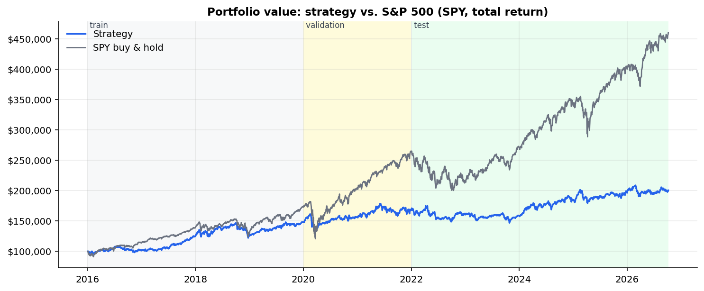
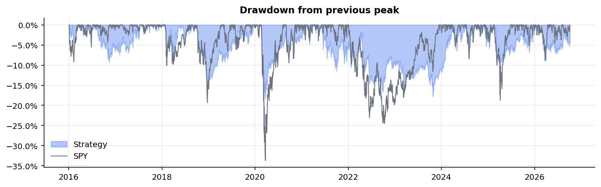
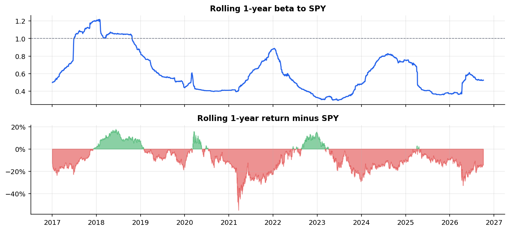
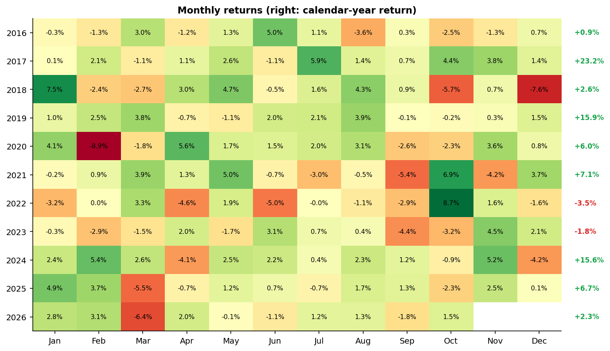
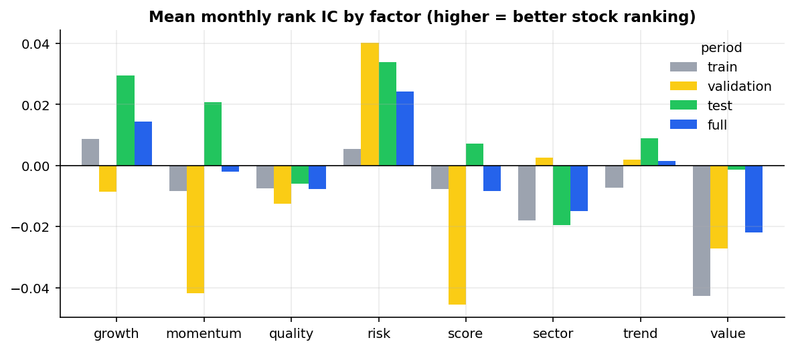
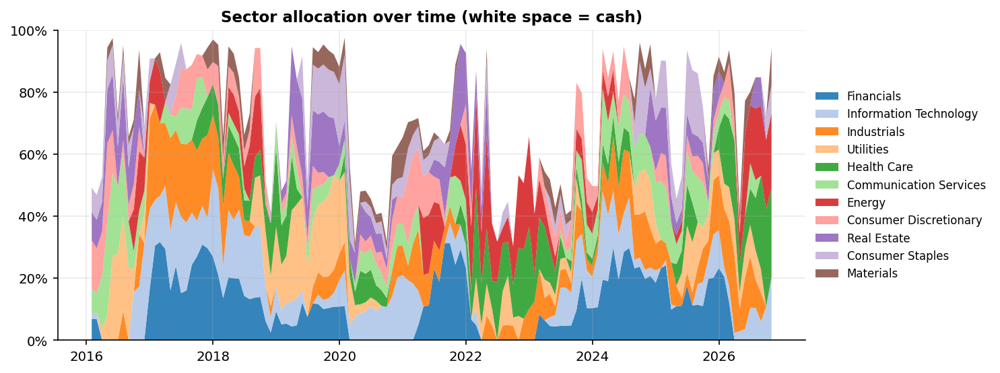
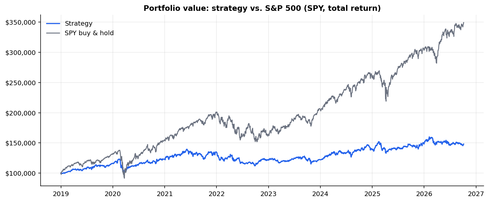
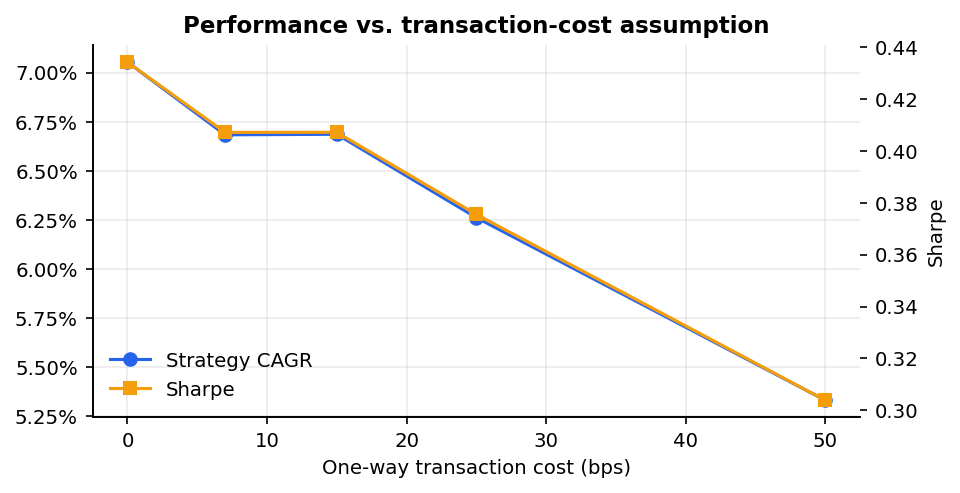
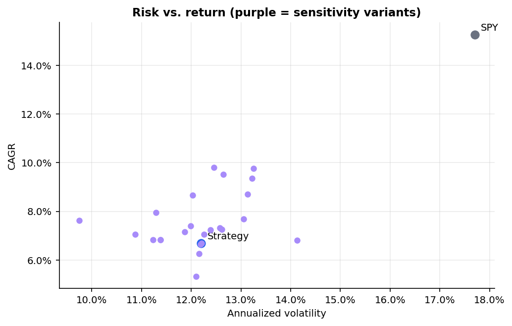
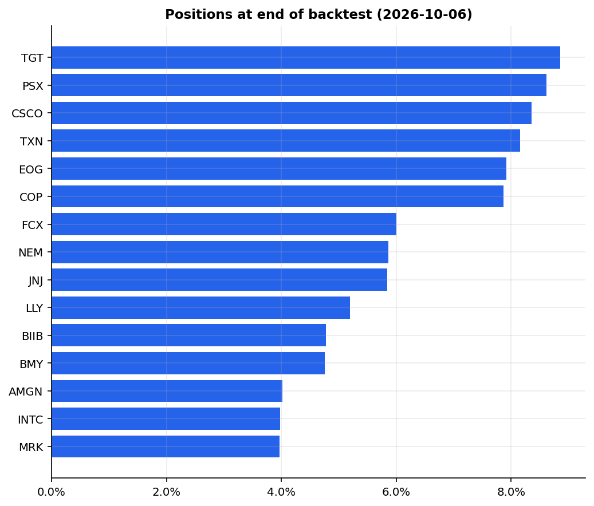

# Performance Report: Algorithmic U.S. Equity Paper Trading & Risk Management System

*Generated 2026-10-06 22:05 from `config/config.yaml`. Simulated results only. Educational project, not investment advice.*

## Headline

- **Full period (2016-01-01 → 2026-10-06)**: $100,000 → **$200,524** (100.5% total, 6.68% CAGR) vs. SPY $460,536 (15.27% CAGR).
- Risk-adjusted: Sharpe **0.41** vs. SPY 0.77; max drawdown **-18.4%** vs. -33.7%; beta 0.49.
- Alpha vs. SPY: **-1.68% per year** (t-stat -0.64; not statistically different from zero).
- **Out-of-sample test (2022-01-01 → 2026-10-06)**: CAGR 3.82% vs. SPY 12.43%; Sharpe 0.04 vs. 0.54.
- Verdict: the strategy **did NOT generate excess risk-adjusted returns** relative to SPY over the full sample.

## Performance metrics

| Metric | Strategy (full) | SPY (full) | Strategy train | Strategy valid. | Strategy TEST | SPY test |
|---|---:|---:|---:|---:|---:|---:|
| Initial capital | $100,000 | $99,930 | $100,000 | $147,772 | $167,726 | $263,517 |
| Final portfolio value | $200,524 | $460,536 | $147,772 | $167,726 | $200,524 | $460,536 |
| Total return | 100.52% | 360.86% | 47.77% | 13.50% | 19.55% | 74.77% |
| CAGR | 6.68% | 15.27% | 10.28% | 6.53% | 3.82% | 12.43% |
| Annualized volatility | 12.20% | 17.70% | 11.58% | 15.27% | 11.21% | 17.31% |
| Sharpe ratio | 0.41 | 0.77 | 0.79 | 0.48 | 0.04 | 0.54 |
| Sortino ratio | 0.55 | 1.08 | 1.08 | 0.65 | 0.05 | 0.78 |
| Maximum drawdown | -18.38% | -33.72% | -16.86% | -18.38% | -16.18% | -24.50% |
| Calmar ratio (CAGR / |MaxDD|) | 0.36 | 0.45 | 0.61 | 0.36 | 0.24 | 0.51 |
| VaR 95% (1-day, historical) | 1.21% | 1.66% | 1.17% | 1.54% | 1.16% | 1.66% |
| Expected Shortfall 95% (1-day) | 1.92% | 2.70% | 1.85% | 2.43% | 1.72% | 2.49% |
| Beta vs. SPY | 0.49 | 1.00 | 0.68 | 0.47 | 0.42 | 1.00 |
| Alpha vs. SPY (CAPM, annualized) | -1.68% | 0.00% | 0.06% | -4.03% | -3.45% | 0.00% |
| Alpha t-statistic | -0.64 | n/a | 0.02 | -0.60 | -0.87 | n/a |
| Information ratio | -0.69 | n/a | -0.48 | -1.02 | -0.67 | n/a |
| Number of trades (fills) | 1,334 |  | 482 | 209 | 643 |  |
| Closed positions (round trips) | 358 |  | 119 | 69 | 170 |  |
| Win rate (closed positions) | 46.65% |  | 51.26% | 52.17% | 41.18% |  |
| Profit factor | 1.52 |  | 2.05 | 2.28 | 1.19 |  |
| Average winning position ($) | $1,231 |  | $908 | $1,268 | $1,493 |  |
| Average losing position ($) | $-706 |  | $-466 | $-608 | $-878 |  |
| Average winning position (%) | 10.38% |  | 9.45% | 12.79% | 9.95% |  |
| Average losing position (%) | -8.10% |  | -6.97% | -8.63% | -8.58% |  |
| Average holding period (days) | 153 |  | 149 | 175 | 146 |  |
| Total trading costs paid | $5,417 |  | $1,558 | $834 | $3,025 |  |
| Average gross exposure | 76.07% |  | 84.84% | 67.03% | 72.54% |  |

S&P 500 *price* index (^GSPC, excludes dividends) over the full period: CAGR 13.45%, Sharpe 0.67, max drawdown -33.9%. SPY (total return) is the fairer benchmark because the strategy's returns include dividends.

## Where did returns come from?

**Beta-matched comparison.** With an average beta of 0.49, a passive portfolio of 0.49× SPY + 0.51× T-bills would have compounded at 8.88%/yr. The strategy compounded at 6.69%/yr, so stock selection + timing contributed **-2.20%/yr** beyond its market exposure.

**Factor information coefficients** (monthly Spearman rank correlation of factor score vs. next-month return; |t| > 2 ≈ statistically meaningful):

| factor   |   train |   train_t |   validation |   validation_t |   test |   test_t |   full |   full_t |
|:---------|--------:|----------:|-------------:|---------------:|-------:|---------:|-------:|---------:|
| growth   |   0.009 |     0.65  |       -0.009 |         -0.297 |  0.03  |    1.935 |  0.015 |    1.463 |
| momentum |  -0.008 |    -0.225 |       -0.042 |         -0.963 |  0.021 |    0.748 | -0.002 |   -0.099 |
| quality  |  -0.007 |    -0.446 |       -0.013 |         -0.45  | -0.006 |   -0.44  | -0.008 |   -0.775 |
| risk     |   0.005 |     0.121 |        0.04  |          0.659 |  0.034 |    0.886 |  0.024 |    0.924 |
| score    |  -0.008 |    -0.198 |       -0.046 |         -0.933 |  0.007 |    0.248 | -0.008 |   -0.388 |
| sector   |  -0.018 |    -0.525 |        0.003 |          0.059 | -0.019 |   -0.723 | -0.015 |   -0.77  |
| trend    |  -0.007 |    -0.193 |        0.002 |          0.034 |  0.009 |    0.339 |  0.002 |    0.073 |
| value    |  -0.043 |    -2.045 |       -0.027 |         -0.96  | -0.001 |   -0.089 | -0.022 |   -1.848 |

**Top 10 contributors ($ P&L, realized + unrealized):**

| ticker   | name                      | sector                 | pnl    |   trades |
|:---------|:--------------------------|:-----------------------|:-------|---------:|
| PSX      | Phillips 66               | Energy                 | $9,227 |       17 |
| GE       | General Electric          | Industrials            | $8,900 |       19 |
| BA       | Boeing                    | Industrials            | $6,766 |       10 |
| MA       | Mastercard                | Financials             | $6,275 |       28 |
| AVGO     | Broadcom (Avago)          | Information Technology | $6,245 |       34 |
| META     | Meta Platforms (Facebook) | Communication Services | $6,111 |       32 |
| T        | AT&T                      | Communication Services | $5,431 |       10 |
| NFLX     | Netflix                   | Communication Services | $5,033 |       27 |
| COP      | ConocoPhillips            | Energy                 | $4,796 |       20 |
| INTC     | Intel                     | Information Technology | $4,674 |       17 |

**Bottom 10 contributors:**

| ticker   | name                         | sector                 | pnl     |   trades |
|:---------|:-----------------------------|:-----------------------|:--------|---------:|
| CRM      | Salesforce                   | Information Technology | $-3,955 |       10 |
| PSA      | Public Storage               | Real Estate            | $-3,554 |       14 |
| FDX      | FedEx                        | Industrials            | $-3,257 |       19 |
| COST     | Costco                       | Consumer Staples       | $-3,154 |       16 |
| BMY      | Bristol-Myers Squibb         | Health Care            | $-2,668 |       10 |
| SLB      | Schlumberger                 | Energy                 | $-2,503 |       15 |
| DUK      | Duke Energy                  | Utilities              | $-2,309 |       13 |
| HD       | Home Depot                   | Consumer Discretionary | $-2,056 |        6 |
| PFE      | Pfizer                       | Health Care            | $-1,900 |        9 |
| AIG      | American International Group | Financials             | $-1,886 |        3 |

**P&L by sector:**

| sector                 | pnl     |   stocks_traded |
|:-----------------------|:--------|----------------:|
| Information Technology | $15,328 |              12 |
| Energy                 | $14,355 |               9 |
| Communication Services | $13,675 |               8 |
| Industrials            | $10,835 |              10 |
| Financials             | $9,870  |              12 |
| Real Estate            | $7,887  |               7 |
| Utilities              | $6,870  |               8 |
| Health Care            | $4,929  |              13 |
| Consumer Discretionary | $2,975  |              10 |
| Materials              | $2,884  |               7 |
| Consumer Staples       | $1,243  |              10 |

**Worst months:**

| date    | monthly_return   |
|:--------|:-----------------|
| 2020-02 | -8.95%           |
| 2018-12 | -7.55%           |
| 2026-03 | -6.35%           |
| 2018-10 | -5.75%           |
| 2025-03 | -5.47%           |

## Stress testing

**Historical episodes** (simulated strategy vs. SPY):

| episode                            | start      | end        | strategy_return   | spy_return   | strategy_max_dd   | difference   |
|:-----------------------------------|:-----------|:-----------|:------------------|:-------------|:------------------|:-------------|
| Q4 2018 sell-off (Fed tightening)  | 2018-09-20 | 2018-12-24 | -15.30%           | -19.35%      | -16.86%           | 4.04%        |
| COVID-19 crash                     | 2020-02-19 | 2020-03-23 | -18.34%           | -33.72%      | -18.34%           | 15.38%       |
| COVID-19 rebound                   | 2020-03-23 | 2020-06-08 | 12.57%            | 44.97%       | -2.40%            | -32.40%      |
| 2022 bear market (inflation/rates) | 2022-01-03 | 2022-10-12 | -9.04%            | -24.50%      | -15.09%           | 15.46%       |
| 2023 regional-bank stress          | 2023-03-08 | 2023-03-17 | -4.30%            | -1.87%       | -4.30%            | -2.43%       |
| 2025 tariff shock                  | 2025-02-19 | 2025-04-08 | -10.83%           | -18.76%      | -10.83%           | 7.92%        |

**Hypothetical instantaneous shocks to the current portfolio:**

| scenario                                     | portfolio_return   | dollar_pnl   |
|:---------------------------------------------|:-------------------|:-------------|
| S&P 500 -5% (beta-scaled)                    | -2.69%             | $-5,394      |
| S&P 500 -10% (beta-scaled)                   | -5.38%             | $-10,788     |
| S&P 500 -20% (beta-scaled)                   | -10.76%            | $-21,577     |
| S&P 500 -35% (beta-scaled)                   | -18.83%            | $-37,760     |
| Health Care sector -25%                      | -7.14%             | $-14,314     |
| Energy sector -25%                           | -6.10%             | $-12,230     |
| Information Technology sector -25%           | -5.12%             | $-10,271     |
| Largest position (TGT) -40% single-stock gap | -3.54%             | $-7,099      |

## Walk-forward (expanding window) out-of-sample test

Each January the configuration with the best Sharpe ratio over *all prior years* is selected from 4 pre-declared candidates and traded for that year.

|   year | chosen      |   in_sample_sharpe | out_of_sample_return   |
|-------:|:------------|-------------------:|:-----------------------|
|   2019 | mom6_vol    |               0.76 | 16.04%                 |
|   2020 | mom6_vol    |               0.89 | 6.29%                  |
|   2021 | mom6_vol    |               0.76 | 9.09%                  |
|   2022 | mom6_vol    |               0.75 | -9.17%                 |
|   2023 | mom6_vol    |               0.52 | 0.04%                  |
|   2024 | mom6_vol    |               0.43 | 13.55%                 |
|   2025 | mom12_equal |               0.48 | 6.61%                  |
|   2026 | mom6_vol    |               0.52 | 0.02%                  |

Stitched walk-forward result: CAGR **5.18%**, Sharpe **0.25**, max drawdown -19.7% vs. SPY CAGR 17.48%, Sharpe 0.79.

## Sensitivity analysis (one parameter at a time; ★ = base case)

| parameter                       | value                 | cagr   | volatility   |   sharpe | max_drawdown   | alpha   |   trades | avg_gross   |   test_sharpe |
|:--------------------------------|:----------------------|:-------|:-------------|---------:|:---------------|:--------|---------:|:------------|--------------:|
| Rebalancing frequency           | weekly                | 9.51%  | 12.64%       |     0.6  | -18.30%        | 0.69%   |     1885 | 82.08%      |          0.48 |
| Rebalancing frequency           | biweekly              | 9.80%  | 12.46%       |     0.63 | -18.60%        | 1.10%   |     1613 | 80.77%      |          0.54 |
| Rebalancing frequency           | ★ monthly             | 6.68%  | 12.20%       |     0.41 | -18.38%        | -1.68%  |     1334 | 76.07%      |          0.04 |
| Rebalancing frequency           | quarterly             | 7.94%  | 11.29%       |     0.53 | -14.15%        | 0.45%   |      806 | 70.55%      |          0.16 |
| Transaction costs (one-way bps) | 0                     | 7.05%  | 12.25%       |     0.43 | -18.30%        | -1.36%  |     1345 | 76.51%      |          0.07 |
| Transaction costs (one-way bps) | ★ 7                   | 6.68%  | 12.20%       |     0.41 | -18.38%        | -1.68%  |     1334 | 76.07%      |          0.04 |
| Transaction costs (one-way bps) | 15                    | 6.69%  | 12.21%       |     0.41 | -18.47%        | -1.67%  |     1340 | 75.80%      |          0.11 |
| Transaction costs (one-way bps) | 25                    | 6.26%  | 12.15%       |     0.38 | -18.62%        | -2.04%  |     1320 | 75.52%      |          0.07 |
| Transaction costs (one-way bps) | 50                    | 5.33%  | 12.10%       |     0.3  | -19.16%        | -2.88%  |     1290 | 75.06%      |          0.02 |
| Max position weight             | 5%                    | 6.82%  | 11.23%       |     0.44 | -16.39%        | -1.38%  |     1047 | 65.59%      |          0.16 |
| Max position weight             | ★ 10%                 | 6.68%  | 12.20%       |     0.41 | -18.38%        | -1.68%  |     1334 | 76.07%      |          0.04 |
| Max position weight             | 15%                   | 6.64%  | 12.19%       |     0.4  | -18.33%        | -1.70%  |     1351 | 76.23%      |          0.04 |
| Number of holdings              | 10                    | 8.71%  | 13.13%       |     0.53 | -18.42%        | 0.12%   |      895 | 74.30%      |          0.41 |
| Number of holdings              | ★ 15                  | 6.68%  | 12.20%       |     0.41 | -18.38%        | -1.68%  |     1334 | 76.07%      |          0.04 |
| Number of holdings              | 20                    | 7.15%  | 11.87%       |     0.45 | -18.49%        | -1.34%  |     1513 | 79.50%      |          0.2  |
| Number of holdings              | 30                    | 7.05%  | 10.87%       |     0.47 | -17.62%        | -1.14%  |     1743 | 79.52%      |          0.07 |
| Momentum lookback (days)        | 126                   | 7.40%  | 11.99%       |     0.47 | -19.75%        | -0.98%  |     1482 | 76.17%      |          0.06 |
| Momentum lookback (days)        | 189                   | 8.67%  | 12.02%       |     0.56 | -21.24%        | 0.26%   |     1319 | 74.99%      |          0.33 |
| Momentum lookback (days)        | ★ 252                 | 6.68%  | 12.20%       |     0.41 | -18.38%        | -1.68%  |     1334 | 76.07%      |          0.04 |
| Volatility target               | 12%                   | 6.82%  | 11.38%       |     0.44 | -18.35%        | -1.26%  |     1299 | 72.01%      |          0.19 |
| Volatility target               | ★ 16%                 | 6.68%  | 12.20%       |     0.41 | -18.38%        | -1.68%  |     1334 | 76.07%      |          0.04 |
| Volatility target               | 20%                   | 7.32%  | 12.58%       |     0.45 | -18.45%        | -1.19%  |     1325 | 77.79%      |          0.09 |
| Volatility target               | none                  | 7.68%  | 13.05%       |     0.46 | -18.52%        | -1.02%  |     1328 | 79.60%      |          0.09 |
| Stop-loss                       | none                  | 9.77%  | 13.26%       |     0.6  | -21.58%        | 0.29%   |     1150 | 80.74%      |          0.46 |
| Stop-loss                       | 1.5x monthly vol      | 6.83%  | 11.38%       |     0.44 | -16.19%        | -0.75%  |     1591 | 74.46%      |          0.26 |
| Stop-loss                       | ★ 2x monthly vol      | 6.68%  | 12.20%       |     0.41 | -18.38%        | -1.68%  |     1334 | 76.07%      |          0.04 |
| Stop-loss                       | 3x monthly vol        | 9.36%  | 13.22%       |     0.57 | -21.61%        | -0.03%  |     1167 | 80.35%      |          0.45 |
| Stop-loss                       | 3x ATR(14) (original) | 7.63%  | 9.74%        |     0.57 | -11.61%        | 1.19%   |     2299 | 65.47%      |          0.45 |
| Position sizing                 | equal                 | 7.25%  | 12.62%       |     0.44 | -18.52%        | -1.40%  |     1192 | 74.98%      |          0.21 |
| Position sizing                 | ★ volatility          | 6.68%  | 12.20%       |     0.41 | -18.38%        | -1.68%  |     1334 | 76.07%      |          0.04 |
| Risk overlay                    | regime filter off     | 6.81%  | 14.13%       |     0.38 | -23.81%        | -2.93%  |     1254 | 80.43%      |          0.07 |
| Risk overlay                    | drawdown control off  | 7.24%  | 12.38%       |     0.45 | -18.38%        | -1.24%  |     1341 | 78.30%      |          0.14 |

## Current portfolio (end of backtest)

## Methodology notes & limitations

- Universe: 109 large caps fixed as of end-2015. 11 constituents (EMC, TWX, WBA, RAI, CELG, ESRX, AGN, APC, MON, PX, EQR) were later acquired/delisted or lack free history and are excluded, a residual **survivorship bias** that likely flatters results.
- Signals use the close of day t; trades fill at the open of t+1 with spread + slippage.
- Fundamentals: SEC EDGAR 10-K data, used only after the filing date (point-in-time).
- Sector labels are current GICS sectors (a small, documented look-ahead).
- Adjusted prices: share counts are in adjusted units; dividends are reinvested via the adjusted series.
- See `RESEARCH_LOG.md` for every design change made after looking at results.
